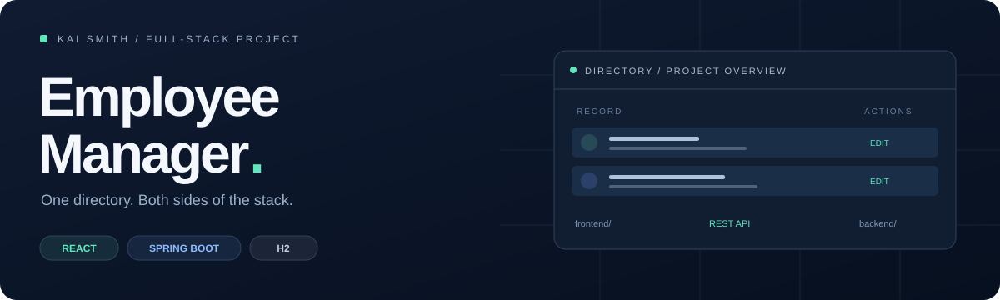
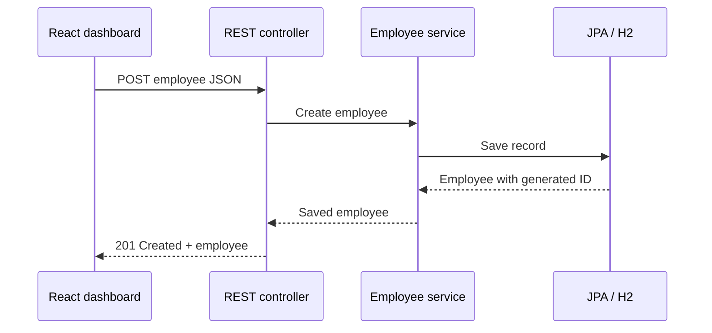

<div align="center">

**A React interface. A Java API. One employee directory.**

[Explore the frontend](frontend/) · [Explore the backend](backend/) · [Run locally](#02--run-the-project) · [API reference](#04--the-api)

</div>

---

## 01 / The project

Employee Manager brings a small employee directory through the full application stack: from a form in the browser, through a REST API, to a database record.

The dashboard lets you view, create, edit, and delete employees. Each record has a generated ID, a first name, a last name, and an email address. The API also supports looking up a record by email.

<table>
<tr>
<td width="50%" valign="top">

### The interface
**JavaScript · React 18 · Vite 5**

Material UI tables and forms, React Router for page navigation, and Axios for API requests.

[Open frontend →](frontend/)

</td>
<td width="50%" valign="top">

### The service
**Java 11 · Spring Boot 2.7.1**

A REST controller, employee service, and Spring Data JPA repository backed by H2. Lombok supplies model boilerplate.

[Open backend →](backend/)

</td>
</tr>
</table>

## 02 / Run the project

**Prerequisites:** Node.js 18+ with npm, JDK 11, and Maven.

```bash
git clone https://github.com/KaiAlexander-commits/Employee-Manager-Dashboard.git
cd Employee-Manager-Dashboard
```

**Terminal one — start the API**

```bash
cd backend
mvn spring-boot:run
```

**Terminal two — start the dashboard from the repository root**

```bash
cd frontend
npm ci
npm run dev -- --port 5174 --strictPort
```

| Open | Address |
| --- | --- |
| Dashboard | http://localhost:5174 |
| Employee API | http://localhost:8080/api/v1/employees |

> **Why port 5174?** The existing backend CORS configuration allows `localhost:5174` and `localhost:4000`. The startup command pins Vite to an allowed origin.

**Try the flow:** open the dashboard, add a sample employee, edit their email, then delete the record from the table.

## 03 / Follow one record

Creating an employee connects the two halves of the project:



| Part | Where to look |
| --- | --- |
| Employee table and delete action | [EmployeeTable.jsx](frontend/src/components/EmployeeTable.jsx) |
| Page routing | [App.jsx](frontend/src/App.jsx) |
| Browser requests and API address | [EmployeeService.js](frontend/src/services/EmployeeService.js) |
| HTTP endpoints | [EmployeeController.java](backend/src/main/java/com/chambers/employeemgrserver/domain/employee/controllers/EmployeeController.java) |
| Employee operations | [EmployeeServiceImpl.java](backend/src/main/java/com/chambers/employeemgrserver/domain/employee/services/EmployeeServiceImpl.java) |
| Database entity | [Employee.java](backend/src/main/java/com/chambers/employeemgrserver/domain/employee/models/Employee.java) |

## 04 / The API

Base URL: `http://localhost:8080/api/v1/employees`

| Method | Path | Result |
| --- | --- | --- |
| `GET` | Base URL | List all employees |
| `POST` | Base URL | Create an employee |
| `GET` | `/{id}` | Retrieve one employee |
| `PUT` | `/{id}` | Update one employee |
| `DELETE` | `/{id}` | Delete one employee |
| `GET` | `/lookup?email={email}` | Find an employee by email |

**Create your first record without opening the UI:**

```bash
curl -X POST http://localhost:8080/api/v1/employees \
  -H "Content-Type: application/json" \
  -d '{"firstName":"Alex","lastName":"Taylor","email":"alex@example.com"}'
```

The server generates the `id`. Create and update requests use `firstName`, `lastName`, and `email`.

<details>
<summary><strong>Frontend routes</strong></summary>

| Route | View |
| --- | --- |
| `/` | Employee list |
| `/add` | Add employee |
| `/update/:id` | Update employee |
| Other paths | 404 page |

</details>

## 05 / Working on it

| Task | Folder | Command |
| --- | --- | --- |
| Build dashboard | `frontend/` | `npm run build` |
| Preview dashboard build | `frontend/` | `npm run preview -- --port 5174 --strictPort` |
| Lint frontend | `frontend/` | `npm run lint` |
| Run backend tests | `backend/` | `mvn test` |
| Package backend | `backend/` | `mvn package` |

The backend includes a Spring Boot context-load test. The frontend currently has no test script.

<details>
<summary><strong>Configuration and local development notes</strong></summary>

- **API address:** edit `frontend/src/services/EmployeeService.js`.
- **Allowed browser origins:** edit `backend/src/main/java/com/chambers/employeemgrserver/domain/employee/controllers/WebConfig.java`.
- **Application settings:** edit `backend/src/main/resources/application.properties`.
- **Database:** embedded H2 with the current Spring Boot defaults. Records are temporary and disappear when the backend restarts.
- **Access controls:** authentication and roles are not implemented. Use sample data for local development.

</details>

---

<div align="center">

**Built by [Kai Smith](https://github.com/KaiAlexander-commits)**

Originally two repositories. Now one project with a clear home for each half.

[Frontend notes](frontend/README.md) · [Backend notes](backend/README.md) · [Original server history](https://github.com/KaiAlexander-commits/Employee-Manager-Server)

</div>
